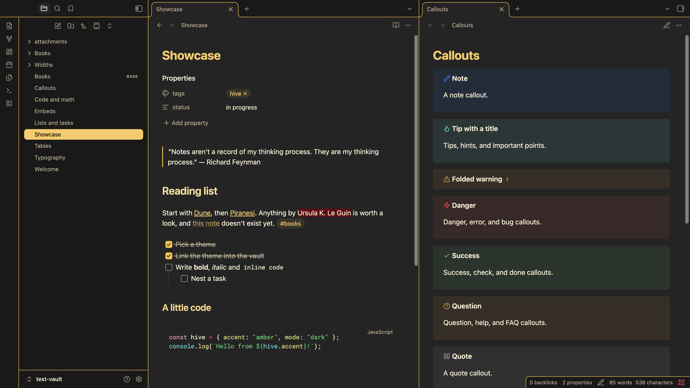
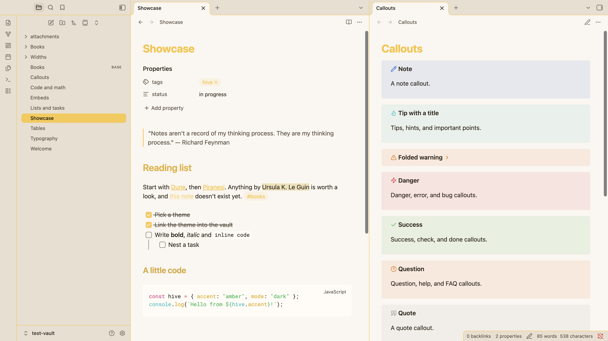

# Hive

A dark/light Obsidian theme that follows your **Settings → Appearance** accent color.

Hive is a fork of [Wasp](https://github.com/santiyounger/Wasp-Obsidian-Theme) by [Santi Younger](https://santiyounger.com/). For the classic Hive look, pick a yellow or amber accent.

## Dark mode

Dark backgrounds with accent-colored highlights.

## Light mode

Light cream backgrounds with accent-colored highlights.

## Install and Use

Hive isn't in Obsidian's community theme directory, so install it by hand:

1. Download `theme.css` and `manifest.json` from the [latest release](https://github.com/ptxmac/Hive-Obsidian-Theme/releases/latest).
2. Put both files in `<your vault>/.obsidian/themes/Hive/`.
3. Go to **Settings → Appearance → Themes** and select **Hive**.
4. Set **Accent color** under Appearance to taste (yellow/amber matches the screenshots).

## Helper classes

Hive supports some of [Minimal's helper classes](https://minimal.guide/features/helper-classes). To use one in a note, add it to the `cssclasses` property:

```yaml
---
cssclasses:
  - table-wide
---
```

### Block widths

These need **Settings → Editor → Readable line length** turned on. Without it, notes already use the full width of the pane.

| Class | Effect |
| --- | --- |
| `wide` | Makes the whole note wide (readable line length + 300px) |
| `max` | Makes the whole note use 88% of the pane |
| `table-wide`, `img-wide`, `iframe-wide` | Makes only tables (including Bases and Dataview tables), images or iframes wide |
| `table-max`, `img-max`, `iframe-max` | Makes only tables, images or iframes use 88% of the pane |
| `table-100`, `img-100`, `iframe-100` | Makes only tables, images or iframes use the full width of the pane |

## Development

`test-vault/` has sample notes for every surface the theme styles. Its theme files are symlinks to this repo. Open it with **Open folder as vault**.

To work on the theme live, start Obsidian with the debug port open and reload the CSS after each edit:

```sh
npm run devtools -- launch                         # restart Obsidian with --remote-debugging-port=9223
npm run devtools -- --vault test-vault reload      # re-read theme.css
npm run devtools -- --vault test-vault screenshot  # save screenshot.png
```

`npm run screenshots` regenerates the README screenshots in `img/` from the test vault. See `scripts/devtools.mjs` for the other commands (`windows`, `eval`, `console`).

## License

MIT — see [LICENSE](LICENSE).

**Hive** by Peter Kristensen, based on **[Wasp](https://github.com/santiyounger/Wasp-Obsidian-Theme)** by Santi Younger.
