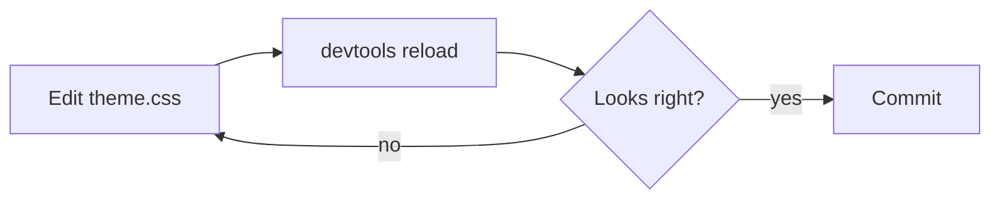

```js
// Syntax highlighting
const greet = (name) => `Hello, ${name}!`;
for (let i = 0; i < 3; i++) console.log(greet("Hive"), i * 2, true, null);
```

```css
.theme-dark {
	--color-accent: #f5c518; /* a comment */
}
```

```
Plain code block with no language, and a very long line that should scroll horizontally rather than wrap if the theme leaves overflow alone.
```

Inline math $e^{i\pi} + 1 = 0$ and a block:

$$
\int_0^\infty e^{-x^2}\,dx = \frac{\sqrt{\pi}}{2}
$$


